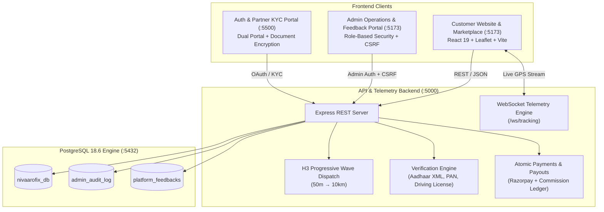
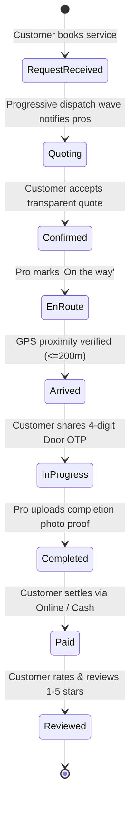
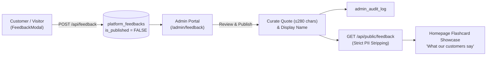

<p align="center">
  <picture>
    <source media="(prefers-color-scheme: dark)" srcset="docs/brand/source/nivaarofix-horizontal-light.svg" />
    <source media="(prefers-color-scheme: light)" srcset="docs/brand/source/nivaarofix-horizontal-dark.svg" />
    
  </picture>
</p>

<p align="center">
  <strong>Elevating the Everyday</strong> &bull; <em>On-Demand Home Services, Real-Time Dispatch & Technician Verification Platform</em>
</p>

<p align="center">
  
  
  
  
  
  
</p>

---

## ⚡ Live Services & Port Directory

When running locally, NivaaroFix synchronizes four core service layers:

| Service | Port | Local URL | Health & Direct Links | Description |
| :--- | :--- | :--- | :--- | :--- |
| **Client Marketplace** | `:5173` | [http://localhost:5173](http://localhost:5173) | [Homepage](http://localhost:5173) &bull; [Services](http://localhost:5173/services) &bull; [My Bookings](http://localhost:5173/my-bookings) | Customer booking portal, interactive problem search, live tracking & customer reviews |
| **Admin Operations Portal** | `:5173` | [http://localhost:5173/#/admin](http://localhost:5173/#/admin) | [Operations](http://localhost:5173/#/admin/operations) &bull; [Approvals](http://localhost:5173/#/admin/approvals) &bull; [Feedback](http://localhost:5173/#/admin/feedback) | Administrative command center: live dispatch radar, partner KYC approvals, and feedback curation |
| **Auth & Partner Portal** | `:5500` | [http://localhost:5500](http://localhost:5500) | [Customer Portal](http://localhost:5500/?portal=customer) &bull; [Partner Console](http://localhost:5500/?portal=agent) | Dual-audience authentication (Google One-Tap, Phone OTP), technician document verification |
| **REST & Telemetry API** | `:5000` | [http://localhost:5000](http://localhost:5000) | [`/api/health`](http://localhost:5000/api/health) &bull; [`/api/public/feedback`](http://localhost:5000/api/public/feedback) | Express REST API, quote engine, H3 spatial dispatch waves, WebSocket tracking (`/ws/tracking`) |
| **PostgreSQL 18 Database** | `:5432` | `127.0.0.1:5432` | Database: `nivaarofix_db` | Relational store with sequential identity codes, audit logs, spatial index & atomic payment ledger |

---

## 🚀 One-Command Quick Start

Start all services simultaneously with automated health verification:

```powershell
# Using npm
npm start

# Or directly via PowerShell
powershell -ExecutionPolicy Bypass -File scripts/start_services.ps1
```

Run the automated test suite covering all domains:

```bash
# Execute full testing matrix
npm run test:all

# Or run individual target suites
npm run test:api       # REST & dispatch endpoints
npm run test:web       # Customer UI, translations & components
npm run test:auth      # Partner & Customer auth flows
npm run test:admin     # Admin security, approvals, and analytics
```

---

## 🏛️ System Architecture



---

## 📚 Interactive Deep Dive

<details>
<summary><strong>🗺️ 1. Geospatial Progressive Wave Dispatch</strong></summary>

<br />

NivaaroFix uses an intelligent multi-tier spatial dispatch architecture designed for instant matching:

- **Uber H3 Spatial Hexagons**: Customer addresses and technician coordinates are indexed to Uber H3 cells (`Resolution 8` ~460m and `Resolution 9` ~170m) using `@h3-js`.
- **Progressive Dispatch Waves**: Requests radiate outward in concentric radius waves (`50m` &rarr; `100m` &rarr; `500m` &rarr; `1km` &rarr; `5km` &rarr; `10km`) to prioritize closest available professionals.
- **Keyless Routing**: Powered by Carto Positron basemaps and public OpenStreetMap / OSRM routing. Switchable to Google Maps or Mapbox via `.env`.

Detailed documentation: [docs/navigation.md](docs/navigation.md).

</details>

<details>
<summary><strong>🔄 2. Complete 12-Step Job State Machine</strong></summary>

<br />



1. **Service Intent Resolution**: Problem matcher maps freeform text (e.g. *"sink blockage"*) to trade (`plumber`) and catalog service.
2. **Geocoding & Job Creation**: Service request recorded with confirmed coordinates and auto-generated Door OTP.
3. **Progressive Dispatch**: Eligible technicians within radius receive anonymous broadcast (customer exact street address withheld for privacy).
4. **Transparent Quotation**: Pros submit itemized price (₹), estimated arrival time (ETA), and warranty terms.
5. **Atomic Assignment**: Quote acceptance executes inside a PostgreSQL transaction lock, transitioning competitor quotes to `Withdrawn` and technician to `BUSY`.
6. **En Route & Live Telemetry**: Bidirectional WebSocket stream delivers road path polyline and sub-second location updates.
7. **Geofence Enforcement**: Server validates technician is within 200m before allowing arrival transition.
8. **Physical Door OTP Verification**: Technician inputs customer's 4-digit door OTP to prove physical presence at doorstep.
9. **In-Progress Work Proof**: Technician completes repairs and attaches mandatory camera/photo proof.
10. **Atomic Payout**: Net payout (`Agreed Quote - 15% Platform Commission`) credited immediately to technician's digital wallet ledger.
11. **30-Day Guarantee**: Warranty coverage activated with automated revisit protection.
12. **Customer Feedback**: Verified 5-star rating updates technician score and completed job counter.

</details>

<details>
<summary><strong>🛡️ 3. Admin Command Center & KYC Approvals</strong></summary>

<br />

The Admin portal (`http://localhost:5173/#/admin`) provides full operations governance:

- **Approvals & KYC Verification**:
  - Offline Aadhaar XML / e-Aadhaar verification with SHA-256 hash checks and tamper-proof storage in `storage/secure_documents`.
  - Driving License, PAN card, and trade certificate verification.
  - Approve, reject with predefined reason codes, or flag for field audit.
- **Operations Radar**: Live tracking of all active requests, unassigned dispatches, en-route technicians, and completion times.
- **Defaulters & Compliance**: Automatically flags technicians with cancellation thresholds or unresolved complaints.
- **Audit Trails**: Every administrative action writes an immutable record to `admin_audit_log` with admin ID, action type, IP address, and payload diffs.

Detailed documentation: [docs/admin.md](docs/admin.md) &bull; [docs/verification.md](docs/verification.md).

</details>

<details>
<summary><strong>💬 4. Customer Feedback & Homepage Publishing System</strong></summary>

<br />



- **Customer Modal**: Built into footer and post-completion flows with 1–5 star ratings and problem category tags.
- **Privacy Preservation**: Customer original text is never overwritten. Public text is stored separately (`public_text`, `public_name`). Contact details (email, phone, user ID) are strictly filtered and never exposed.
- **Interactive Flashcard Deck**: Displayed on homepage when $\ge 1$ feedback items are published; auto-advances every 5 seconds, supports keyboard navigation, touch swipe, and auto-pause on hover.

</details>

<details>
<summary><strong>💳 5. Online Payments, Escrow & Technician Payouts</strong></summary>

<br />

- **Customer Payment Options**: Razorpay UPI / Cards / Net Banking or Pay on Completion (Cash).
- **Escrow & Commission**: Automatically calculates 15% platform commission and 85% technician net earnings.
- **Instant Bank Payouts**: Automated IMPS / UPI transfers with payout receipts generated and downloadable as PDF.

Detailed documentation: [docs/payments.md](docs/payments.md).

</details>

<details>
<summary><strong>📦 6. Monorepo Structure & Clean Directory Standards</strong></summary>

<br />

```
NivaaroFIX/
├── apps/
│   ├── api/                   # Express REST API & WebSocket telemetry server (:5000)
│   │   ├── src/
│   │   │   ├── config/        # Database pool, JWT, and dispatch configurations
│   │   │   ├── modules/       # Domain modules (analytics, dispatch, payments, quotes, tracking, verification)
│   │   │   ├── routes/        # Express route controllers (admin, auth, bookings, feedback, payments)
│   │   │   └── utils/         # Geo-math (Haversine), H3 utils, security, money utils
│   │   └── tests/             # API integration and E2E test suites
│   ├── web/                   # Customer marketplace & Admin portal (:5173)
│   │   ├── src/
│   │   │   ├── components/    # Reusable UI widgets, BookingProgressTracker, FeedbackModal, PublishedFeedbackSection
│   │   │   ├── context/       # BookingContext, PartnerContext, LanguageContext
│   │   │   ├── pages/         # HomePage, ServicesPage, MyBookingsPage, AdminLandingPage, AdminFeedbackPage
│   │   │   └── styles/        # Warm Ivory & Emerald Green design system
│   │   └── public/            # Brand logos, manifest, and static images
│   └── auth/                  # Customer & Partner authentication portal (:5500)
│       ├── src/
│       │   ├── components/    # OTP input, modals, GPS location popover, document preview
│       │   └── pages/         # CustomerPortalPage, AgentPortalPage, Profiles
│       └── public/            # Favicons, vector logos, PWA assets
├── database/
│   ├── migrations/            # Versioned SQL migrations (001_initial_schema.sql through 021_realtime_data_and_referential_integrity.sql)
│   └── reference-data/        # Reference catalogs (service_catalog.sql)
├── docs/                      # Architectural specifications & engineering guides
│   ├── admin.md               # Admin operations, feedback, and approvals guide
│   ├── api.md                 # Complete REST API reference
│   ├── database.md            # PostgreSQL schema dictionary & tables
│   ├── navigation.md          # Maps, H3 dispatch & routing system
│   ├── payments.md            # Payments, commissions, and payout ledger
│   ├── verification.md        # Technician KYC & UIDAI verification specifications
│   ├── brand/                 # Brand guidelines & SVG logos
│   └── design-specs/          # UI wireframes & visual specifications
├── packages/
│   └── shared/                # Shared enums, constants, and business invariants
├── scripts/                   # System automation, startup, and migration runners
│   ├── admin_cli.js           # Admin account creation & password management CLI
│   ├── admin_seed.js          # Admin role seeding script
│   ├── migrate.js             # Safe sequential migration runner
│   ├── fresh_db_reset.js      # Clean database reset utility
│   ├── start_services.ps1     # Multi-service launcher with automated port checks
│   ├── generate_brand_assets.mjs  # SVG/PNG brand asset generation pipeline
│   ├── lint_*.mjs             # Brand color and typography lint rules
│   ├── build_*_knowledge_bundle.mjs  # LLM knowledge bundle generators
│   └── sanitize_support_tickets.mjs  # PII sanitization for support data
└── tests/                     # Workspace-level E2E integration test suites
```

</details>

<details>
<summary><strong>🗄️ 7. Database Migrations Ledger (001 – 021)</strong></summary>

<br />

All migrations are tracked and verified inside the `schema_migrations` table:

1. `001_initial_schema.sql` - Core entities (users, customers, professionals, service_requests, bookings)
2. `002_booking_progress_timestamps.sql` - Milestone tracking (`en_route_at`, `arrived_at`, `in_progress_at`)
3. `003_secure_sessions_and_audit.sql` - Session store and basic audit logging
4. `004_remove_dob_state_city_hub.sql` - Streamlined registration profile schema
5. `005_online_payments_and_payouts.sql` - Payment intents, wallet ledger, and technician payout tables
6. `006_professional_verification.sql` - Professional verification documents and status tracking
7. `007_enforce_single_trade_foreign_key.sql` - Strict single trade specialization integrity
8. `008_add_professional_base_location.sql` - Base dispatch coordinates and service radius
9. `009_admin_operations_complaints_and_defaulters.sql` - Complaints, flags, and defaulters ledger
10. `010_permanent_address_and_working_location.sql` - Address dual-typing (permanent vs current working)
11. `011_admin_auth_and_audit.sql` - Admin RBAC (`owner`, `admin`, `auditor`) and session tokens
12. `012_admin_approvals_system.sql` - Verification review queues and resolution logs
13. `013_admin_analytics_indices.sql` - High-performance composite indices for analytics
14. `014_platform_feedback.sql` - Platform feedback table and categorization
15. `015_admin_feedback_management.sql` - Admin publishing flags and resolution tracking
16. `016_feedback_publishing_system.sql` - Public display fields (`public_text`, `public_name`) & audit hooks
17. `017_store_full_manual_aadhaar.sql` - Full manual Aadhaar entry support
18. `018_purge_full_aadhaar_numbers.sql` - Privacy purge of raw Aadhaar numbers
19. `019_support_tickets_system.sql` - Customer support ticketing tables
20. `020_support_ticket_updates_and_timeline.sql` - Ticket timeline and status updates
21. `021_realtime_data_and_referential_integrity.sql` - Realtime data constraints and referential integrity

</details>

---

## 🛠️ Developer Scripts Reference

| Command | Action |
| :--- | :--- |
| `npm start` | Launch all 4 services (PostgreSQL, API, Web, Auth) with health verification |
| `npm run dev:api` | Launch Express REST API backend standalone on `:5000` |
| `npm run dev:web` | Launch Client & Admin React application on `:5173` |
| `npm run dev:auth` | Launch Auth & Partner React application on `:5500` |
| `npm run build` | Compile production bundles for both Web and Auth frontends |
| `npm run db:reset` | Run safe sequential migrations runner (`scripts/migrate.js`) |
| `npm run db:clean` | Purge transactional test records while retaining catalog & admin seeds |
| `npm run admin:create` | Interactively provision a new Admin or Owner account |
| `npm run admin:seed` | Seed default administrative superuser accounts |
| `npm run test:all` | Run complete end-to-end integration and security test suite |
| `npm run lint:brand` | Validate zero banned brand colors or foreign color tokens |

---

## 📄 License

This project is licensed under the MIT License — see the [LICENSE](LICENSE) file for details.

<p align="center">
  <sub>Built with precision for <strong>NivaaroFix</strong> &bull; Elevating the Everyday</sub>
</p>
