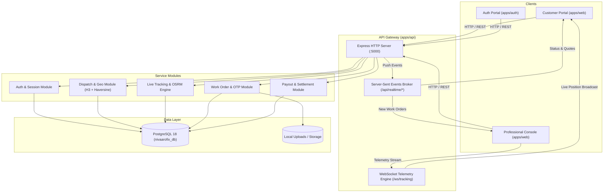

# System Architecture

## Overview

NivaaroFix is an on-demand home service marketplace platform connecting residential customers with verified trade professionals (electricians and plumbers). The platform coordinates request broadcast, competitive quotation, exclusive job locking, turn-by-turn road tracking, physical doorstep OTP verification, job completion proof, and wallet settlement.

## Monorepo Layout

```
nivaarofix/
├── apps/
│   ├── api/          # Express REST API & WebSocket telemetry server
│   ├── web/          # Customer dashboard & professional console (React + Vite)
│   └── auth/         # Customer & partner authentication portal (React + Vite)
├── packages/
│   └── shared/       # Shared domain constants, enums, and configuration tokens
├── database/
│   ├── migrations/   # Sequential database migrations (001_initial_schema.sql)
│   └── reference-data/ # Static reference data (service catalog)
├── docs/             # Technical specifications and architectural guides
└── scripts/          # Developer tooling and database reset utilities
```

## System Architecture Diagram



## Key Architectural Principles

1. **Mutual Exclusivity Guard**: Both customer and professional operate under strict single-active-job locks during active states (`confirmed`, `on_the_way`, `arrived`, `in_progress`).
2. **Doorstep Physicality Validation**: High-accuracy GPS geofence checks verify that professionals are within 200 meters of the customer confirmed doorstep pin before allowing the arrival transition. Door OTP is strictly obscured until arrival is confirmed.
3. **Decoupled Keyless Maps**: The mapping pipeline runs in keyless development mode using Leaflet, Carto Positron vector tiles, and OSRM road routing. Production traffic tiles (Google Maps Platform or Mapbox) are configured via environment variables with zero code changes.
