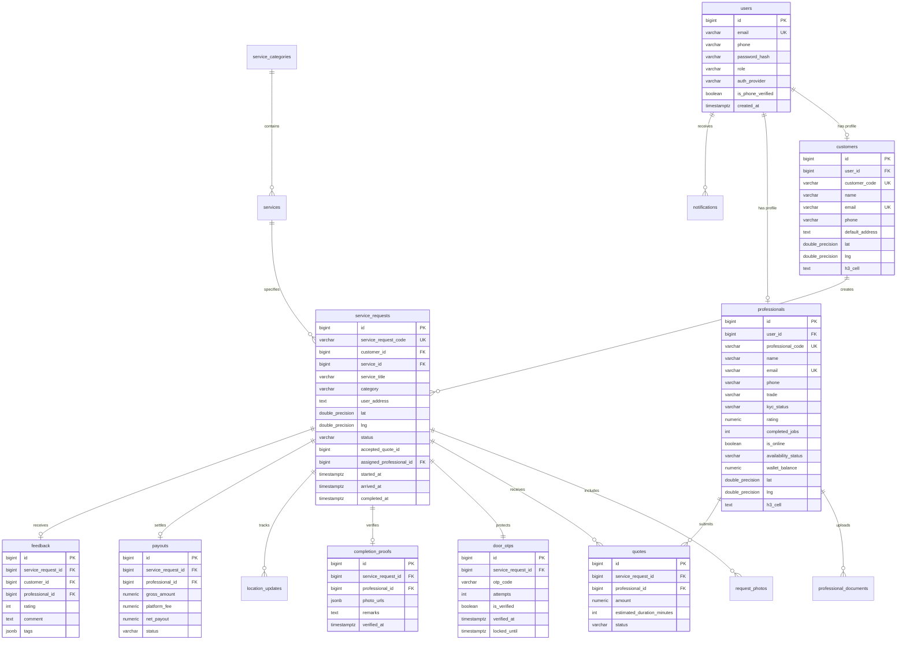

# Database Schema & Entity Relationship

## Overview

The NivaaroFix database is implemented on PostgreSQL using a strictly numbered, sequential identity architecture. All primary keys are `BIGINT GENERATED ALWAYS AS IDENTITY`.

## Public Numbering Conventions

Human-facing entity codes are generated from an atomic sequence counter (`code_sequences`) tracking the calendar year and counter value.

| Entity | Code Pattern | Example | Notes |
| :--- | :--- | :--- | :--- |
| `customers` | `YYYY` + 5 digits | `202600001` | Sequential per year |
| `professionals` | `YYYY` + 5 digits | `202600001` | Sequential per year |
| `service_requests` | `YYYY` + 6 digits | `2026000001` | Sequential per year |

## Entity Relationship Diagram

## Data Dictionary

### 1. `code_sequences`
Tracks atomic counter sequences per entity and calendar year.
- `id` (BIGINT, PK): Identity column.
- `entity` (VARCHAR(50)): Entity name (`customer`, `professional`, `service_request`).
- `year` (INT): Calendar year.
- `last_value` (BIGINT): Last issued numeric sequence value.
- `updated_at` (TIMESTAMPTZ): Timestamp of last sequence increment.

### 2. `users`
Master user accounts for customers, professionals, and administrators.
- `id` (BIGINT, PK): Identity column.
- `email` (VARCHAR(255), UNIQUE): Login email address.
- `phone` (VARCHAR(32)): Mobile number.
- `password_hash` (VARCHAR(255)): Bcrypt password hash.
- `role` (VARCHAR(32)): User role (`customer`, `professional`, `admin`).
- `auth_provider` (VARCHAR(32)): Authentication source (`local`, `google`, `phone_otp`, `agent_id`).
- `is_phone_verified` (BOOLEAN): Phone verification flag.
- `is_active` (BOOLEAN): Account operational status.

### 3. `customers`
Customer demographic and location profile.
- `id` (BIGINT, PK): Identity column.
- `user_id` (BIGINT, FK): References `users(id)`.
- `customer_code` (VARCHAR(32), UNIQUE): Sequential code (`YYYY` + 5 digits).
- `name` (VARCHAR(150)): Customer full name.
- `email` (VARCHAR(255), UNIQUE): Customer email address.
- `phone` (VARCHAR(32)): Customer contact phone number.
- `default_address` (TEXT): Saved doorstep delivery address.
- `lat` (DOUBLE PRECISION): Saved doorstep latitude.
- `lng` (DOUBLE PRECISION): Saved doorstep longitude.
- `h3_cell` (TEXT): H3 index resolution 9 cell.

### 4. `professionals`
Registered and verified trade technicians.
- `id` (BIGINT, PK): Identity column.
- `user_id` (BIGINT, FK): References `users(id)`.
- `professional_code` (VARCHAR(32), UNIQUE): Sequential partner code (`YYYY` + 5 digits).
- `name` (VARCHAR(150)): Full technician name.
- `email` (VARCHAR(255), UNIQUE): Partner contact email.
- `phone` (VARCHAR(32)): Contact phone number.
- `trade` (VARCHAR(64)): Trade specialization (`electrician`, `plumber`).
- `experience_years` (INT): Years of field experience.
- `kyc_status` (VARCHAR(32)): Verification status (`pending`, `verified`, `rejected`).
- `rating` (NUMERIC(3,2)): Average review score (1.00 to 5.00).
- `completed_jobs` (INT): Count of finished work orders.
- `is_online` (BOOLEAN): Availability to receive nearby dispatch broadcasts.
- `availability_status` (VARCHAR(32)): Status (`available`, `busy`, `offline`).
- `wallet_balance` (NUMERIC(12,2)): Available balance in INR.
- `lat` (DOUBLE PRECISION): Current latitude.
- `lng` (DOUBLE PRECISION): Current longitude.
- `h3_cell` (TEXT): H3 index resolution 9 cell.

### 5. `service_requests`
Primary marketplace work order.
- `id` (BIGINT, PK): Identity column.
- `service_request_code` (VARCHAR(32), UNIQUE): Sequential reference (`YYYY` + 6 digits).
- `customer_id` (BIGINT, FK): References `customers(id)`.
- `service_id` (BIGINT, FK): References `services(id)`.
- `service_title` (VARCHAR(200)): Selected service title.
- `category` (VARCHAR(64)): Category name (`electrician`, `plumber`).
- `issue_type` (VARCHAR(150)): Problem symptom.
- `problem_description` (TEXT): Customer diagnostic remarks.
- `user_address` (TEXT): Doorstep service location.
- `lat` (DOUBLE PRECISION): Confirmed doorstep pin latitude.
- `lng` (DOUBLE PRECISION): Confirmed doorstep pin longitude.
- `status` (VARCHAR(32)): Work order status (`open`, `quoted`, `confirmed`, `on_the_way`, `arrived`, `in_progress`, `completed`, `cancelled`).
- `accepted_quote_id` (BIGINT): ID of accepted quote.
- `assigned_professional_id` (BIGINT, FK): References `professionals(id)`.
- `started_at` (TIMESTAMPTZ): Start timestamp after door OTP entry.
- `arrived_at` (TIMESTAMPTZ): Doorstep arrival timestamp.
- `completed_at` (TIMESTAMPTZ): Finished work order timestamp.

### 6. `quotes`
Competitive price quotations submitted by nearby professionals.
- `id` (BIGINT, PK): Identity column.
- `service_request_id` (BIGINT, FK): References `service_requests(id)`.
- `professional_id` (BIGINT, FK): References `professionals(id)`.
- `amount` (NUMERIC(12,2)): Quoted price in INR (strictly > 0).
- `estimated_duration_minutes` (INT): Estimated duration.
- `message` (TEXT): Note to customer.
- `status` (VARCHAR(32)): Status (`pending`, `accepted`, `rejected`, `expired`).

### 7. `door_otps`
Physical presence verification codes.
- `id` (BIGINT, PK): Identity column.
- `service_request_id` (BIGINT, FK, UNIQUE): References `service_requests(id)`.
- `otp_code` (VARCHAR(10)): 4-digit numeric code.
- `attempts` (INT): Verification attempt count.
- `is_verified` (BOOLEAN): Verification outcome flag.
- `verified_at` (TIMESTAMPTZ): Verification completion timestamp.
- `locked_until` (TIMESTAMPTZ): Lockout timestamp after 5 failed entries.

### 8. `completion_proofs`
Photographic proof uploaded upon work completion.
- `id` (BIGINT, PK): Identity column.
- `service_request_id` (BIGINT, FK): References `service_requests(id)`.
- `professional_id` (BIGINT, FK): References `professionals(id)`.
- `photo_urls` (JSONB): Array of 1 to 4 photo URLs.
- `remarks` (TEXT): Technician closing remarks.
- `verified_at` (TIMESTAMPTZ): Validation timestamp.

### 9. `payouts`
Financial transactions and earnings credits.
- `id` (BIGINT, PK): Identity column.
- `service_request_id` (BIGINT, FK): References `service_requests(id)`.
- `professional_id` (BIGINT, FK): References `professionals(id)`.
- `gross_amount` (NUMERIC(12,2)): Accepted quote total.
- `platform_fee` (NUMERIC(12,2)): Commission deduction (15%).
- `net_payout` (NUMERIC(12,2)): Net amount credited to wallet (85%).
- `status` (VARCHAR(32)): Ledger status (`credited`, `settled`, `reversed`).

### 10. `payments`
Online customer payments captured via Razorpay Standard Checkout.
- `id` (BIGINT, PK): Identity column.
- `payment_code` (VARCHAR(32), UNIQUE): Sequential human-readable code (`YYYY` + 6 digits).
- `service_request_id` (BIGINT, FK): References `service_requests(id)`.
- `customer_id` (BIGINT, FK): References `customers(id)`.
- `amount` (NUMERIC(12,2)): Gross total paid in INR.
- `amount_paise` (BIGINT): Integer amount in paise (1 INR = 100 paise).
- `currency` (VARCHAR(10)): Defaults to `'INR'`.
- `status` (VARCHAR(32)): Payment state (`due`, `processing`, `paid`, `failed`, `refunded`).
- `provider` (VARCHAR(32)): Payment driver (`razorpay` or `mock`).
- `gateway_order_id` (VARCHAR(128)): Razorpay order identifier (`order_...`).
- `gateway_payment_id` (VARCHAR(128)): Captured payment identifier (`pay_...`).
- `platform_fee` (NUMERIC(12,2)): Platform commission deduction.
- `platform_fee_paise` (BIGINT): Platform fee in paise.
- `agent_amount` (NUMERIC(12,2)): Professional share.
- `agent_amount_paise` (BIGINT): Professional share in paise.
- `captured_at` (TIMESTAMPTZ): Gateway capture timestamp.

### 11. `payment_attempts`
Audit log of individual checkout and gateway attempts.
- `id` (BIGINT, PK): Identity column.
- `payment_id` (BIGINT, FK): References `payments(id)`.
- `gateway_order_id` (VARCHAR(128)): Associated order ID.
- `gateway_payment_id` (VARCHAR(128)): Associated payment ID.
- `method` (VARCHAR(32)): Gateway payment method (`upi`, `card`, `netbanking`, `wallet`).
- `status` (VARCHAR(32)): Attempt outcome (`initiated`, `authorized`, `captured`, `failed`).
- `error_code` (VARCHAR(64)): Gateway error code on rejection.
- `error_description` (TEXT): Human-readable error message.

### 12. `payment_transfers`
Route automated settlements transferring professional shares to linked bank accounts.
- `id` (BIGINT, PK): Identity column.
- `payment_id` (BIGINT, FK): References `payments(id)`.
- `professional_id` (BIGINT, FK): References `professionals(id)`.
- `recipient_account_id` (VARCHAR(128)): Gateway linked account (`acc_...`).
- `amount` (NUMERIC(12,2)): Transferred professional share in INR.
- `amount_paise` (BIGINT): Transferred share in paise.
- `currency` (VARCHAR(10)): Defaults to `'INR'`.
- `gateway_transfer_id` (VARCHAR(128)): Gateway transfer reference (`trf_...`).
- `status` (VARCHAR(32)): Route status (`pending`, `processed`, `failed`, `reversed`).
- `failure_reason` (TEXT): Diagnostic note on settlement error.

### 13. `refunds`
Administrative payment reversals and pro share debit records.
- `id` (BIGINT, PK): Identity column.
- `payment_id` (BIGINT, FK): References `payments(id)`.
- `amount` (NUMERIC(12,2)): Reversal amount in INR.
- `amount_paise` (BIGINT): Reversal amount in paise.
- `gateway_refund_id` (VARCHAR(128)): Gateway refund identifier (`rfnd_...`).
- `status` (VARCHAR(32)): Status (`initiated`, `processed`, `failed`).
- `reason` (TEXT): Justification for the refund.

### 14. `webhook_events`
Idempotent log of raw webhooks received from payment gateways.
- `id` (BIGINT, PK): Identity column.
- `event_id` (VARCHAR(128), UNIQUE): Gateway webhook event identifier.
- `event_type` (VARCHAR(64)): Webhook action (`payment.captured`, `transfer.processed`, etc.).
- `payload` (JSONB): Full raw webhook event body.
- `processed_at` (TIMESTAMPTZ): Server handling timestamp.
- `status` (VARCHAR(32)): Processing state (`processed`, `ignored`, `failed`).

### Updated Professional Permanent Address, Experience & Working Location Columns
On `professionals` and `agent_login`:
- `permanent_address` (TEXT): Doorstep permanent residence address, never overwritten by live GPS coordinates.
- `years_of_experience` (SMALLINT, 0..50): Experience years. `0` represents "Fresher" across quotes and profiles.
- `current_latitude` (DOUBLE PRECISION): Live working GPS latitude, active only while Available.
- `current_longitude` (DOUBLE PRECISION): Live working GPS longitude, active only while Available.
- `current_accuracy_m` (DOUBLE PRECISION): Hardware GPS accuracy in meters.
- `current_h3_cell` (VARCHAR(32)): Spatial H3 index cell for dispatch matching.
- `current_locality` (VARCHAR(255)): Cached human-readable locality string ("Working near <locality>").
- `location_updated_at` (TIMESTAMPTZ): Timestamp of last GPS heartbeat or positional update.
- `offline_reason` (VARCHAR(64)): Inactivity reason (e.g. `'heartbeat_timeout'`) when 2-minute threshold lapses.

### 15. `mobile_verifications`
Cryptographically secure mobile OTP storage with HMAC hashes and attempt tracking.
- `id` (BIGINT, PK): Identity column.
- `phone` (VARCHAR(32)): E.164 or normalized 10-digit mobile number.
- `code_hash` (VARCHAR(128)): HMAC-SHA256 hex digest using server secret. Plain OTP is never stored.
- `attempts` (INT): Failed verification attempts counter (max 5).
- `max_attempts` (INT): Attempt ceiling.
- `ip_address` (VARCHAR(64)): Client IP address for hourly rate limiting.
- `expires_at` (TIMESTAMPTZ): 5-minute expiration timestamp.
- `consumed_at` (TIMESTAMPTZ): Consumption timestamp preventing replay.

### 16. `professional_documents`
Encrypted government documents with automated compliance checks and privacy retention.
- `id` (BIGINT, PK): Identity column.
- `professional_id` (BIGINT, FK): References `professionals(id)`.
- `document_type` (VARCHAR(32)): `'aadhaar'` or `'driving_licence'`.
- `status` (VARCHAR(32)): `'not_uploaded'`, `'uploading'`, `'under_review'`, `'verified'`, `'needs_attention'`, `'rejected'`.
- `encrypted_file_path` (TEXT): Encrypted file path (AES-256-GCM ciphertext).
- `file_iv` (VARCHAR(64)): 12-byte hex initialization vector.
- `file_auth_tag` (VARCHAR(64)): 16-byte hex authentication tag.
- `mime_type` (VARCHAR(64)): Verified mime type via magic bytes.
- `file_size_bytes` (INT): File size (max 5 MB).
- `aadhaar_last4` (VARCHAR(4)): Strictly last 4 digits of Aadhaar (full number never stored).
- `document_expiry` (DATE): Expiry date for driving licences.
- `consent_at` (TIMESTAMPTZ): Professional consent timestamp.
- `checks` (JSONB): Automated check results (quality, OCR, Verhoeff, QR signature, name similarity).
- `rejection_reason` (TEXT): Human administrator explanation on rejection.
- `reviewed_by` (BIGINT, FK): Admin user ID.
- `reviewed_at` (TIMESTAMPTZ): Review timestamp.
- `delete_after` (TIMESTAMPTZ): File retention cutoff date (default 30 days).

### 17. `professional_photos`
Live portrait captures with facial hint scores and privacy retention.
- `id` (BIGINT, PK): Identity column.
- `professional_id` (BIGINT, FK): References `professionals(id)`.
- `encrypted_file_path` (TEXT): Encrypted file path (AES-256-GCM).
- `file_iv` (VARCHAR(64)): GCM initialization vector.
- `file_auth_tag` (VARCHAR(64)): GCM authentication tag.
- `mime_type` (VARCHAR(64)): Image mime type.
- `is_upload_fallback` (BOOLEAN): True if captured via upload fallback when camera unavailable.
- `face_similarity_score` (NUMERIC(5,2)): Automated comparison score against Aadhaar photo. Advisory hint only.
- `status` (VARCHAR(32)): `'under_review'`, `'verified'`, `'rejected'`.
- `checks` (JSONB): Image quality and facial presence metrics.
- `delete_after` (TIMESTAMPTZ): File retention cutoff date.

### 18. `verification_audit_log`
Immutable audit ledger for administrative review decisions and verification actions.
- `id` (BIGINT, PK): Identity column.
- `professional_id` (BIGINT, FK): References `professionals(id)`.
- `actor_id` (BIGINT, FK): Admin or system user ID.
- `actor_email` (VARCHAR(255)): Admin email.
- `action` (VARCHAR(64)): Specific action (`mobile_sent`, `mobile_verified`, `document_uploaded`, `document_approved`, etc.).
- `target_type` (VARCHAR(32)): `'mobile'`, `'document'`, `'photo'`, `'professional'`.
- `target_id` (BIGINT): Target entity ID.
- `reason` (TEXT): Admin note or template reason.
- `metadata` (JSONB): Contextual action parameters.
- `ip_address` (VARCHAR(64)): Request IP address.

