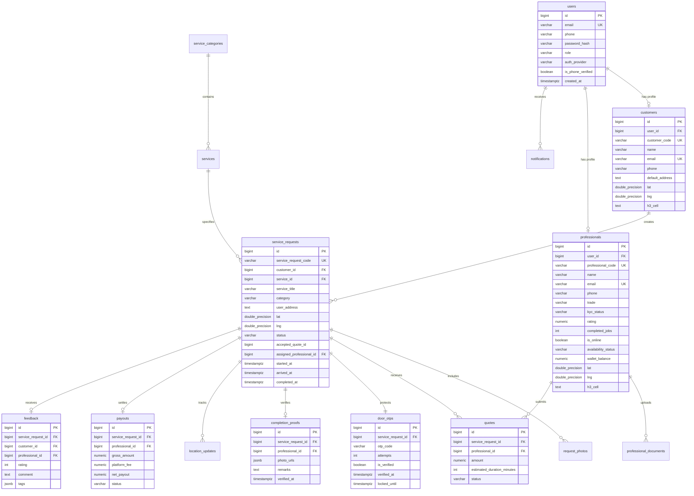

# Database Schema & Entity Relationship

## Overview

The NivaaroFix database is implemented on PostgreSQL using a strictly numbered, sequential identity architecture. All primary keys are `BIGINT GENERATED ALWAYS AS IDENTITY`.

## Public Numbering Conventions

Human-facing entity codes are generated from an atomic sequence counter (`code_sequences`) tracking the calendar year and counter value.

| Entity | Code Pattern | Example | Notes |
| :--- | :--- | :--- | :--- |
| `customers` | `YYYY` + 5 digits | `202600001` | Sequential per year |
| `professionals` | `YYYY` + 5 digits | `202600001` | Sequential per year |
| `service_requests` | `YYYY` + 6 digits | `2026000001` | Sequential per year |

## Entity Relationship Diagram

## Data Dictionary

### 1. `code_sequences`
Tracks atomic counter sequences per entity and calendar year.
- `id` (BIGINT, PK): Identity column.
- `entity` (VARCHAR(50)): Entity name (`customer`, `professional`, `service_request`).
- `year` (INT): Calendar year.
- `last_value` (BIGINT): Last issued numeric sequence value.
- `updated_at` (TIMESTAMPTZ): Timestamp of last sequence increment.

### 2. `users`
Master user accounts for customers, professionals, and administrators.
- `id` (BIGINT, PK): Identity column.
- `email` (VARCHAR(255), UNIQUE): Login email address.
- `phone` (VARCHAR(32)): Mobile number.
- `password_hash` (VARCHAR(255)): Bcrypt password hash.
- `role` (VARCHAR(32)): User role (`customer`, `professional`, `admin`).
- `auth_provider` (VARCHAR(32)): Authentication source (`local`, `google`, `phone_otp`, `agent_id`).
- `is_phone_verified` (BOOLEAN): Phone verification flag.
- `is_active` (BOOLEAN): Account operational status.

### 3. `customers`
Customer demographic and location profile.
- `id` (BIGINT, PK): Identity column.
- `user_id` (BIGINT, FK): References `users(id)`.
- `customer_code` (VARCHAR(32), UNIQUE): Sequential code (`YYYY` + 5 digits).
- `name` (VARCHAR(150)): Customer full name.
- `email` (VARCHAR(255), UNIQUE): Customer email address.
- `phone` (VARCHAR(32)): Customer contact phone number.
- `default_address` (TEXT): Saved doorstep delivery address.
- `lat` (DOUBLE PRECISION): Saved doorstep latitude.
- `lng` (DOUBLE PRECISION): Saved doorstep longitude.
- `h3_cell` (TEXT): H3 index resolution 9 cell.

### 4. `professionals`
Registered and verified trade technicians.
- `id` (BIGINT, PK): Identity column.
- `user_id` (BIGINT, FK): References `users(id)`.
- `professional_code` (VARCHAR(32), UNIQUE): Sequential partner code (`YYYY` + 5 digits).
- `name` (VARCHAR(150)): Full technician name.
- `email` (VARCHAR(255), UNIQUE): Partner contact email.
- `phone` (VARCHAR(32)): Contact phone number.
- `trade` (VARCHAR(64)): Trade specialization (`electrician`, `plumber`).
- `experience_years` (INT): Years of field experience.
- `kyc_status` (VARCHAR(32)): Verification status (`pending`, `verified`, `rejected`).
- `rating` (NUMERIC(3,2)): Average review score (1.00 to 5.00).
- `completed_jobs` (INT): Count of finished work orders.
- `is_online` (BOOLEAN): Availability to receive nearby dispatch broadcasts.
- `availability_status` (VARCHAR(32)): Status (`available`, `busy`, `offline`).
- `wallet_balance` (NUMERIC(12,2)): Available balance in INR.
- `lat` (DOUBLE PRECISION): Current latitude.
- `lng` (DOUBLE PRECISION): Current longitude.
- `h3_cell` (TEXT): H3 index resolution 9 cell.

### 5. `service_requests`
Primary marketplace work order.
- `id` (BIGINT, PK): Identity column.
- `service_request_code` (VARCHAR(32), UNIQUE): Sequential reference (`YYYY` + 6 digits).
- `customer_id` (BIGINT, FK): References `customers(id)`.
- `service_id` (BIGINT, FK): References `services(id)`.
- `service_title` (VARCHAR(200)): Selected service title.
- `category` (VARCHAR(64)): Category name (`electrician`, `plumber`).
- `issue_type` (VARCHAR(150)): Problem symptom.
- `problem_description` (TEXT): Customer diagnostic remarks.
- `user_address` (TEXT): Doorstep service location.
- `lat` (DOUBLE PRECISION): Confirmed doorstep pin latitude.
- `lng` (DOUBLE PRECISION): Confirmed doorstep pin longitude.
- `status` (VARCHAR(32)): Work order status (`open`, `quoted`, `confirmed`, `on_the_way`, `arrived`, `in_progress`, `completed`, `cancelled`).
- `accepted_quote_id` (BIGINT): ID of accepted quote.
- `assigned_professional_id` (BIGINT, FK): References `professionals(id)`.
- `started_at` (TIMESTAMPTZ): Start timestamp after door OTP entry.
- `arrived_at` (TIMESTAMPTZ): Doorstep arrival timestamp.
- `completed_at` (TIMESTAMPTZ): Finished work order timestamp.

### 6. `quotes`
Competitive price quotations submitted by nearby professionals.
- `id` (BIGINT, PK): Identity column.
- `service_request_id` (BIGINT, FK): References `service_requests(id)`.
- `professional_id` (BIGINT, FK): References `professionals(id)`.
- `amount` (NUMERIC(12,2)): Quoted price in INR (strictly > 0).
- `estimated_duration_minutes` (INT): Estimated duration.
- `message` (TEXT): Note to customer.
- `status` (VARCHAR(32)): Status (`pending`, `accepted`, `rejected`, `expired`).

### 7. `door_otps`
Physical presence verification codes.
- `id` (BIGINT, PK): Identity column.
- `service_request_id` (BIGINT, FK, UNIQUE): References `service_requests(id)`.
- `otp_code` (VARCHAR(10)): 4-digit numeric code.
- `attempts` (INT): Verification attempt count.
- `is_verified` (BOOLEAN): Verification outcome flag.
- `verified_at` (TIMESTAMPTZ): Verification completion timestamp.
- `locked_until` (TIMESTAMPTZ): Lockout timestamp after 5 failed entries.

### 8. `completion_proofs`
Photographic proof uploaded upon work completion.
- `id` (BIGINT, PK): Identity column.
- `service_request_id` (BIGINT, FK): References `service_requests(id)`.
- `professional_id` (BIGINT, FK): References `professionals(id)`.
- `photo_urls` (JSONB): Array of 1 to 4 photo URLs.
- `remarks` (TEXT): Technician closing remarks.
- `verified_at` (TIMESTAMPTZ): Validation timestamp.

### 9. `payouts`
Financial transactions and earnings credits.
- `id` (BIGINT, PK): Identity column.
- `service_request_id` (BIGINT, FK): References `service_requests(id)`.
- `professional_id` (BIGINT, FK): References `professionals(id)`.
- `gross_amount` (NUMERIC(12,2)): Accepted quote total.
- `platform_fee` (NUMERIC(12,2)): Commission deduction (15%).
- `net_payout` (NUMERIC(12,2)): Net amount credited to wallet (85%).
- `status` (VARCHAR(32)): Ledger status (`credited`, `settled`, `reversed`).
