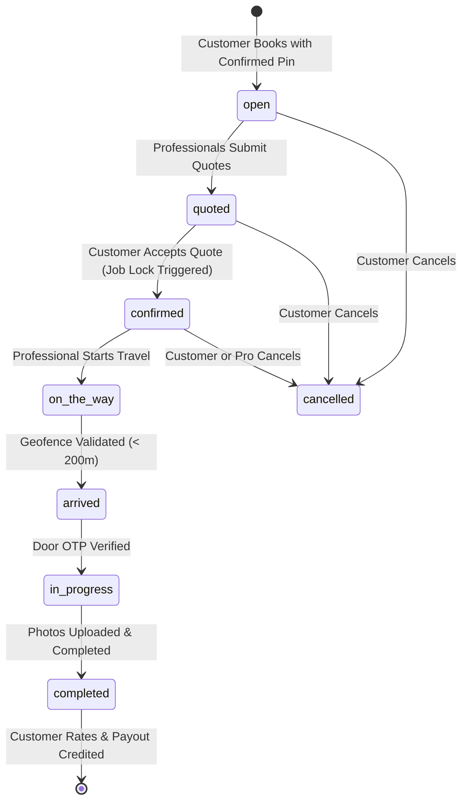

# Job Lifecycle & State Transitions

## State Machine Overview

A service request advances through a strictly enforced, unidirectional finite state machine.

## State Definitions & Invariants

| State | Allowed Transitions | Invariants & Pre-conditions |
| :--- | :--- | :--- |
| `open` | `quoted`, `cancelled` | Customer location confirmed. Request broadcast to nearby matching pros. |
| `quoted` | `confirmed`, `cancelled` | At least one competitive quote submitted. |
| `confirmed` | `on_the_way`, `cancelled` | Customer accepted quote. Single-job lock active for customer and pro. |
| `on_the_way` | `arrived`, `cancelled` | Professional location telemetry streaming every 3-5s. |
| `arrived` | `in_progress` | Professional GPS verified within 200m of customer pin. Door OTP revealed. |
| `in_progress` | `completed` | Correct 4-digit Door OTP entered. Job timer running. |
| `completed` | None | 1 to 4 completion photos uploaded. Payout credited to pro wallet. |
| `cancelled` | None | Terminal state. Job locks released immediately. |

## H3 Geospatial Dispatch & Progressive Radius

When a service request is created:
1. The customer's confirmed latitude and longitude are converted to an H3 Resolution 9 index (~100m hex cell).
2. The initial dispatch wave queries active, online professionals matching the trade within k-ring 1 (~1.5 km).
3. If no quote is accepted within 60 seconds, the dispatch radius expands to k-ring 2 (~3.5 km), followed by k-ring 3 (~7 km).
4. Distance calculation between professional and customer is strictly computed from live GPS coordinates using the Haversine formula.

## Mutual Exclusivity Locking Rules

1. **Customer Job Lock**:
   - A customer cannot create a concurrent service request if they currently have an active request in states `confirmed`, `on_the_way`, `arrived`, or `in_progress`.
   - Any concurrent booking attempt returns `403 CUSTOMER_LOCKED`.
2. **Professional Job Lock**:
   - A professional cannot submit quotes or receive new assignments if engaged on a job in states `confirmed`, `on_the_way`, `arrived`, or `in_progress`.
   - Any quote submission attempt returns `409 PROVIDER_BUSY`.

## Door OTP Physical Presence Verification

1. The Door OTP is a cryptographically random 4-digit code generated during booking creation.
2. The code is strictly obscured from both customer and technician until the professional transitions to `arrived`.
3. The server permits the `arrived` transition only if the professional's reported coordinates are within 200 meters of the customer's confirmed destination coordinates.
4. Security throttling:
   - If an incorrect OTP is entered, attempts increment.
   - Upon reaching 5 failed attempts, OTP entry is locked for 15 minutes (`429 Too Many Requests`).

## Completion Proof & Payout Settlement

1. To transition from `in_progress` to `completed`, the professional must upload between 1 and 4 photos of the finished work along with optional remarks.
2. Upon verification:
   - Gross quote amount is retrieved from the accepted quote.
   - Platform commission (15%) is calculated and logged.
   - Net payout (85%) is credited to the professional's wallet.
   - A row is inserted into `payouts` and `wallet_transactions`.
   - The tracking WebSocket channel is destroyed.
