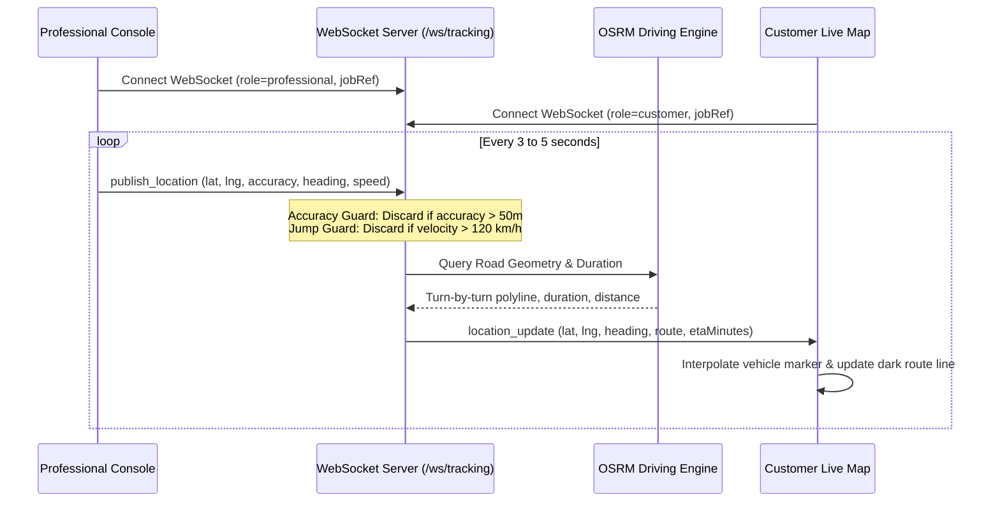

# Live Tracking Architecture

## Overview

The live tracking pipeline streams high-accuracy GPS coordinates from the assigned professional to the customer en-route screen in real time. It calculates turn-by-turn road routes, estimates traffic-aware ETAs, detects anomalies, and renders animated vehicle markers.

## Telemetry Pipeline

## Security & Scoping Rules

1. **Per-Job Isolation**: Telemetry channels are identified strictly by `jobRef`. Only the assigned professional can publish coordinates to a channel; only that specific job's customer can subscribe.
2. **Data Cleansing**:
   - Readings with horizontal accuracy worse than 50 meters are discarded.
   - Sudden coordinate jumps (>120 km/h) are rejected as sensor glitches.
   - Coordinates are smoothed using moving-average interpolation.
3. **Lifecycle Cleanup**:
   - When a job completes or cancels, the in-memory WebSocket room and all associated location breadcrumbs are immediately destroyed.

## Fallback Mechanisms

1. **HTTP Fallback**: If the client environment restricts persistent WebSockets, the professional console falls back to `POST /api/dispatch/job/:ref/location`.
2. **Server-Sent Events (SSE)**: The customer console listens on `/api/dispatch/request/:ref/events` for push notifications if WebSocket connectivity fails.
3. **Routing Fallback**: If the OSRM public API is unreachable or times out (>2500ms), the server falls back to straight-line Euclidean interpolation and Haversine distance with an assumed city driving speed of 25 km/h.
