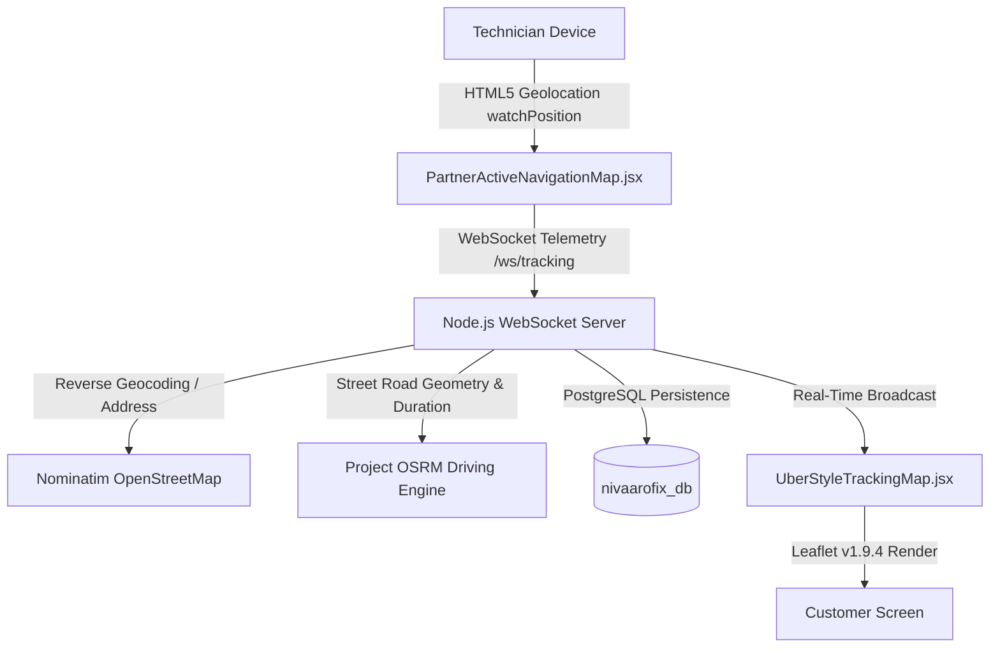
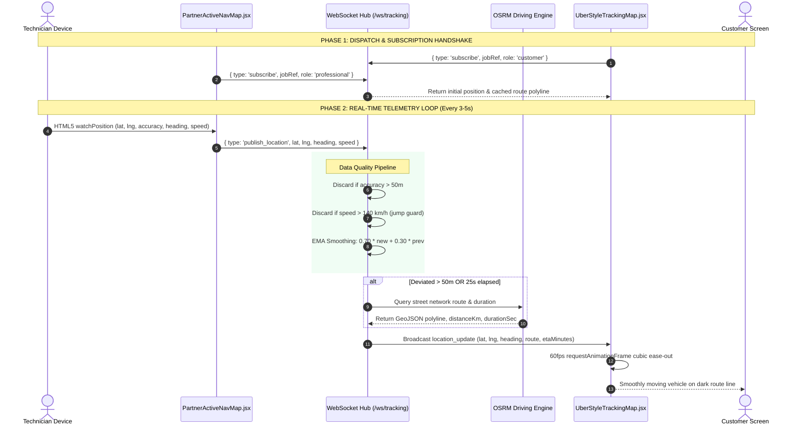

# NivaaroFix — Maps Architecture & Real-Time Tracking Master Specification

> **Complete All-in-One Technical Reference, Mathematical Formulations, Architecture Flowcharts, and Production Guide.**  
> *Optimized for direct AI processing and PDF generation.*

---

## Table of Contents
1. [Executive Overview](#1-executive-overview)
2. [Why Maps Previously Failed vs. How They Work Now](#2-why-maps-previously-failed-vs-how-they-work-now)
3. [Complete Technology Stack & Tooling](#3-complete-technology-stack--tooling)
4. [Component Architecture & Front-End Modules](#4-component-architecture--front-end-modules)
5. [Real-Time Telemetry Pipeline & Protocols](#5-real-time-telemetry-pipeline--protocols)
6. [Mathematical Formulas & Spatial Algorithms (Full Derivations)](#6-mathematical-formulas--spatial-algorithms-full-derivations)
   - 6.1 [Spherical Haversine Distance Formula](#61-spherical-haversine-distance-formula)
   - 6.2 [Great-Circle Forward Azimuth (Compass Heading)](#62-great-circle-forward-azimuth-compass-heading)
   - 6.3 [Exponential Moving Average (EMA) Coordinate Smoothing](#63-exponential-moving-average-ema-coordinate-smoothing)
   - 6.4 [Impossible Jump & Outlier Detection Filter](#64-impossible-jump--outlier-detection-filter)
   - 6.5 [60fps Cubic Ease-Out Marker Interpolation](#65-60fps-cubic-ease-out-marker-interpolation)
   - 6.6 [ETA Models: Street Routing vs. Urban Velocity Heuristic](#66-eta-models-street-routing-vs-urban-velocity-heuristic)
7. [System Architecture Flowcharts & Sequence Diagrams](#7-system-architecture-flowcharts--sequence-diagrams)
8. [Production Deployment Strategy: OSM vs. Commercial Providers](#8-production-deployment-strategy-osm-vs-commercial-providers)
9. [Zero-Code Provider Migration Guide](#9-zero-code-provider-migration-guide)
10. [Local Verification & Health Endpoints](#10-local-verification--health-endpoints)

---

## 1. Executive Overview

The **NivaaroFix Maps & Real-Time Tracking Platform** powers on-demand home service fulfillment (Electricians, Plumbers, and Technicians). It connects customer dispatch interfaces with service technician devices in real time, delivering turn-by-turn navigation, dynamic ETA computation, sub-second coordinate streaming, and smooth 60fps vehicle animations.

```
┌───────────────────────────────────────────────────────────────────────────────────────────┐
│                                NIVAAROFIX MAPS ECOSYSTEM                                  │
└─────────────────────────────────────────────┬─────────────────────────────────────────────┘
                                              │
       ┌──────────────────────────────────────┼──────────────────────────────────────┐
       ▼                                      ▼                                      ▼
┌────────────────────────────┐  ┌────────────────────────────┐  ┌───────────────────────────┐
│     CLIENT ACQUISITION     │  │     BACKEND TELEMETRY      │  │     MAP VISUALIZATION     │
│  - HTML5 watchPosition     │  │  - WebSocket /ws/tracking  │  │  - Leaflet v1.9.4         │
│  - High Accuracy (<20m)    │  │  - Jump & Accuracy Filters │  │  - OpenStreetMap Tiles    │
│  - Bearing Calculation     │  │  - EMA Smoothing (α=0.70)  │  │  - Dual-Layer Polyline    │
│  - Live Speed Tracking     │  │  - OSRM Road Route Engine  │  │  - 60fps Ease-Out Marker  │
└────────────────────────────┘  └────────────────────────────┘  └───────────────────────────┘
```

---

## 2. Why Maps Previously Failed vs. How They Work Now

Earlier iterations of the system experienced blank tiles, vertical tile stacking, or initialization crashes. The table below provides a root-cause analysis and explains the exact architectural solutions implemented:

| Issue | Previous Symptom | Root Cause | Solution Implemented in Codebase |
|---|---|---|---|
| **Commercial API Key Requirement** | Grey screen / 401 Unauthorized / Console errors | Code expected Google Maps or Mapbox keys without fallbacks. | **Keyless OpenStreetMap Default:** Configured standard OSM tiles (`https://{s}.tile.openstreetmap.org/{z}/{x}/{y}.png`). Requires **zero API keys** for development while allowing seamless runtime configuration for Mapbox or Google Maps. |
| **Missing Leaflet CSS** | Tiles loaded as broken, stacked vertical images down the page; controls misaligned. | `leaflet/dist/leaflet.css` was not imported into component modules. | **Explicit CSS Import:** `import 'leaflet/dist/leaflet.css';` is explicitly imported in every map component. |
| **0px Height Container Collapse** | Grey map with missing tiles when rendered in tabs, modals, or animated cards. | Leaflet initialized while container had `0px` height before DOM paint. | **Strict Dimensions & Invalidation:** Applied explicit container heights (`height: 280px` / `380px`) and added `map.invalidateSize()` lifecycle triggers on mount. |
| **Undefined Coordinate Crash** | React crashed with `Invalid LatLng object: (NaN, NaN)`. | Profile or booking lacked coordinates during initial render. | **Graceful Coordinate Normalization:** Normalized all inputs with fallback coordinates centered on Bangalore (`[12.9716, 77.5946]`) until hardware GPS converges. |
| **Vehicle Coordinate Snapping** | Vehicle jumped or flickered sharply when new coordinates arrived. | Raw sensor jitter was applied directly to marker position. | **Exponential Smoothing & 60fps Interpolation:** Backend rejects readings `> 50m` inaccuracy, and frontend uses `requestAnimationFrame` with cubic easing. |

---

## 3. Complete Technology Stack & Tooling

The platform combines open-source libraries and protocols to deliver performance without upfront API costs:



1. **Map Rendering Library:** **Leaflet v1.9.4** (Lightweight ~42KB gzipped, mobile-optimized, canvas/SVG rendering).
2. **Basemap Tile Provider:** **OpenStreetMap Standard Raster CDN** (`https://{s}.tile.openstreetmap.org/{z}/{x}/{y}.png`). Clean, fast, and keyless.
3. **Turn-by-Turn Routing Engine:** **Project OSRM (Open Source Routing Machine)** driving profile (`https://router.project-osrm.org/route/v1/driving/...`).
4. **Reverse Geocoding Engine:** **OSM Nominatim** (proxied via `/api/geo/reverse` with direct client fallback) matched against Indian administrative datasets.
5. **Real-Time Transport:** Native **WebSockets (`ws`)** over `/ws/tracking` with HTTP POST (`/api/dispatch/job/:ref/location`) and SSE (`/api/dispatch/request/:ref/events`) fallbacks.

---

## 4. Component Architecture & Front-End Modules

The mapping subsystem is organized into 4 dedicated, modular React components:

```
c:\NivaaroFIX\apps\web\src\components\
├── UberStyleTrackingMap.jsx       <-- Customer en-route live vehicle tracking
├── PartnerActiveNavigationMap.jsx <-- Professional turn-by-turn navigation console
├── UberProximityRadarMap.jsx      <-- Customer booking radius & nearby pros radar
└── DoorstepPinMap.jsx             <-- Draggable pin doorstep locator
```

### 4.1. `UberStyleTrackingMap.jsx` (Customer View)
- **File:** [`apps/web/src/components/UberStyleTrackingMap.jsx`](../../apps/web/src/components/UberStyleTrackingMap.jsx)
- **Role:** Visualizes the assigned professional driving toward the customer's doorstep.
- **Key Features:**
  - **Dual-Layer Route Polyline:** Renders a 7px white outer casing (`#ffffff`) underneath a 4px dark route line (`#111827`) for high contrast against street tiles.
  - **60fps Marker Tweening:** Uses `requestAnimationFrame` and a cubic ease-out curve so the vehicle glides smoothly between GPS updates instead of jumping.
  - **Camera Follow Mode:** Automatically pans the map to keep the technician centered while allowing manual pan/zoom override.
  - **Connection Stall Guard:** Monitors time elapsed since the last telemetry packet and displays a warning if no update has arrived in $> 15$ seconds.

### 4.2. `PartnerActiveNavigationMap.jsx` (Technician Console)
- **File:** [`apps/web/src/components/PartnerActiveNavigationMap.jsx`](../../apps/web/src/components/PartnerActiveNavigationMap.jsx)
- **Role:** Mounted on the technician's console during transit.
- **Key Features:**
  - **Hardware GPS Acquisition:** Subscribes to `navigator.geolocation.watchPosition` with `{ enableHighAccuracy: true, maximumAge: 5000, timeout: 15000 }`.
  - **Dynamic Bearing Orientation:** Calculates forward azimuth angle and rotates the directional emerald navigation arrow marker.
  - **Dual Telemetry Broadcast:** Transmits updates over WebSocket `/ws/tracking` and triggers HTTP fallback `POST /api/dispatch/job/:ref/location`.
  - **Built-in Route Simulation Engine:** Allows developers and QA to test navigation by simulating movement along OSRM route coordinates without driving.

### 4.3. `UberProximityRadarMap.jsx` (Booking Radar)
- **File:** [`apps/web/src/components/UberProximityRadarMap.jsx`](../../apps/web/src/components/UberProximityRadarMap.jsx)
- **Role:** Displayed on the customer booking screen before dispatch.
- **Key Features:**
  - Displays customer doorstep pin with a pulsing green sonar ripple animation.
  - Renders search radius boundaries (3km, 7km, 15km).
  - Fetches and displays nearby verified technicians with trade-specific pins (Electrician Lightning Bolt vs. Plumber Water Droplet).

### 4.4. `DoorstepPinMap.jsx` (Address Pin Locator)
- **File:** [`apps/web/src/components/DoorstepPinMap.jsx`](../../apps/web/src/components/DoorstepPinMap.jsx)
- **Role:** Used in profile setup and booking confirmation.
- **Key Features:**
  - Interactive draggable pin marker with reverse geocoding on drag-end.
  - Map click listener to instantly snap marker to any clicked building or doorway.

---

## 5. Real-Time Telemetry Pipeline & Protocols

```
[Professional Browser / Mobile]
       │
       ├──> (1) WebSocket: /ws/tracking (Type: publish_location)
       └──> (2) HTTP Fallback: POST /api/dispatch/job/:ref/location
                     │
                     ▼
       [Node.js WebSocket Hub & Telemetry Pipeline]
                     │
                     ├──> Step A: Verify Pro Assigned to Job
                     ├──> Step B: Drop Accuracy > 50m
                     ├──> Step C: Drop Jumps > 500m in <5s (>140 km/h)
                     ├──> Step D: Smooth Coordinates (α = 0.70)
                     ├──> Step E: Query OSRM Route (if dev > 50m or 25s elapsed)
                     └──> Step F: Broadcast to Customer Channel
                                   │
                                   ▼
                     [Customer UberStyleTrackingMap]
                     (60fps Marker Tween + Route Redraw)
```

### Protocol Payloads

#### Client Subscription Handshake
```json
{
  "type": "subscribe",
  "jobRef": "SR-2026-00042",
  "role": "professional",
  "email": "technician@nivaarofix.com"
}
```

#### Professional Location Packet (Published Every 3–5 Seconds)
```json
{
  "type": "publish_location",
  "jobRef": "SR-2026-00042",
  "lat": 12.971598,
  "lng": 77.594562,
  "accuracy": 8,
  "heading": 142,
  "speed": 28.4,
  "email": "technician@nivaarofix.com"
}
```

#### Customer Broadcast Packet
```json
{
  "type": "location_update",
  "jobRef": "SR-2026-00042",
  "lat": 12.971612,
  "lng": 77.594580,
  "heading": 142,
  "speed": 28.4,
  "accuracy": 8,
  "route": [
    [12.971612, 77.594580],
    [12.971940, 77.595120],
    [12.972500, 77.596000]
  ],
  "distanceKm": 1.85,
  "etaMinutes": 6,
  "updatedAt": "2026-10-26T22:45:00.000Z"
}
```

---

## 6. Mathematical Formulas & Spatial Algorithms (Full Derivations)

### 6.1. Spherical Haversine Distance Formula

The **Haversine formula** determines the great-circle distance between two points on the Earth's surface using their latitudes and longitudes.

#### Derivation & Equations
Let two points on a sphere be $P_1 = (\phi_1, \lambda_1)$ and $P_2 = (\phi_2, \lambda_2)$ where $\phi$ represents latitude and $\lambda$ represents longitude in radians:

$$\phi = \text{degrees} \cdot \frac{\pi}{180}, \quad \lambda = \text{degrees} \cdot \frac{\pi}{180}$$

The coordinate deltas are:
$$\Delta \phi = \phi_2 - \phi_1 = \frac{(\text{lat}_2 - \text{lat}_1) \cdot \pi}{180}$$
$$\Delta \lambda = \lambda_2 - \lambda_1 = \frac{(\text{lng}_2 - \text{lng}_1) \cdot \pi}{180}$$

The square of half the chord length between the points ($a$) is given by:
$$a = \sin^2\left(\frac{\Delta \phi}{2}\right) + \cos(\phi_1) \cdot \cos(\phi_2) \cdot \sin^2\left(\frac{\Delta \lambda}{2}\right)$$

The angular distance in radians ($c$) is:
$$c = 2 \cdot \text{atan2}\left(\sqrt{a}, \sqrt{1 - a}\right)$$

The distance $d$ across Earth's volumetric mean radius ($R = 6,371.0088\text{ km}$) is:
$$d = R \cdot c = 6371.0088 \cdot 2 \cdot \text{atan2}\left(\sqrt{a}, \sqrt{1 - a}\right)$$

#### JavaScript Implementation
```javascript
export function haversineDistance(lat1, lng1, lat2, lng2) {
  const R = 6371.0088; // Earth radius in km
  const toRad = Math.PI / 180;
  const dLat = (lat2 - lat1) * toRad;
  const dLng = (lng2 - lng1) * toRad;
  
  const a =
    Math.sin(dLat / 2) * Math.sin(dLat / 2) +
    Math.cos(lat1 * toRad) * Math.cos(lat2 * toRad) *
    Math.sin(dLng / 2) * Math.sin(dLng / 2);
    
  const c = 2 * Math.atan2(Math.sqrt(a), Math.sqrt(1 - a));
  return R * c;
}
```

---

### 6.2. Great-Circle Forward Azimuth (Compass Heading)

Calculates the forward azimuth angle $\theta \in [0^\circ, 360^\circ)$ along the great-circle arc from $P_1$ to $P_2$. This determines the rotation angle of the directional navigation arrow icon.

#### Equations
$$y = \sin(\Delta \lambda) \cdot \cos(\phi_2)$$
$$x = \cos(\phi_1) \cdot \sin(\phi_2) - \sin(\phi_1) \cdot \cos(\phi_2) \cdot \cos(\Delta \lambda)$$
$$\theta = \text{atan2}(y, x) \cdot \frac{180}{\pi}$$
$$\text{Bearing} = (\theta + 360) \pmod{360}$$

#### JavaScript Implementation
```javascript
export function computeBearing(lat1, lng1, lat2, lng2) {
  const toRad = Math.PI / 180;
  const toDeg = 180 / Math.PI;
  const dLng = (lng2 - lng1) * toRad;
  const phi1 = lat1 * toRad;
  const phi2 = lat2 * toRad;

  const y = Math.sin(dLng) * Math.cos(phi2);
  const x =
    Math.cos(phi1) * Math.sin(phi2) -
    Math.sin(phi1) * Math.cos(phi2) * Math.cos(dLng);

  const brng = Math.atan2(y, x) * toDeg;
  return Math.round((brng + 360) % 360);
}
```

---

### 6.3. Exponential Moving Average (EMA) Coordinate Smoothing

Raw hardware GPS coordinates fluctuate due to satellite geometry and atmospheric delays. To eliminate noise, the backend applies an **Exponential Moving Average (EMA)** filter:

#### Equations
$$\hat{\phi}_t = \alpha \cdot \phi_{t,\text{raw}} + (1 - \alpha) \cdot \hat{\phi}_{t-1}$$
$$\hat{\lambda}_t = \alpha \cdot \lambda_{t,\text{raw}} + (1 - \alpha) \cdot \hat{\lambda}_{t-1}$$

Where:
- $\alpha = 0.70$ (Optimal smoothing parameter: 70% current signal responsiveness, 30% historical stability).
- $\hat{\phi}_{t-1}, \hat{\lambda}_{t-1}$ = Previously confirmed smoothed position.

#### JavaScript Implementation
```javascript
function smoothCoordinates(rawLat, rawLng, prevPosition, alpha = 0.70) {
  if (!prevPosition) return { lat: rawLat, lng: rawLng };
  const smoothedLat = parseFloat((alpha * rawLat + (1 - alpha) * prevPosition.lat).toFixed(6));
  const smoothedLng = parseFloat((alpha * rawLng + (1 - alpha) * prevPosition.lng).toFixed(6));
  return { lat: smoothedLat, lng: smoothedLng };
}
```

---

### 6.4. Impossible Jump & Outlier Detection Filter

Filters erroneous cell-tower triangulation spikes:

#### Equations
$$\Delta t = \frac{t_t - t_{t-1}}{1000} \quad (\text{elapsed seconds})$$
$$\Delta d = \text{HaversineDistance}(P_{t-1}, P_t) \quad (\text{kilometers})$$
$$v = \frac{\Delta d}{\Delta t / 3600} \quad (\text{velocity in km/h})$$

#### Rejection Rule:
$$\text{Filter Decision} = \begin{cases} 
\text{REJECT}, & \text{if } \text{Accuracy} > 50\text{ meters} \\ 
\text{REJECT}, & \text{if } \Delta d > 0.5\text{ km} \land \Delta t < 5\text{ s} \land v > 140\text{ km/h} \\ 
\text{ACCEPT}, & \text{otherwise} 
\end{cases}$$

---

### 6.5. 60fps Cubic Ease-Out Marker Interpolation

Telemetry packets arrive at discrete intervals (every 3 to 5 seconds). To prevent the vehicle icon from teleporting across the screen, the frontend executes smooth coordinate interpolation over $T_{\text{duration}} = 650\text{ms}$ using `requestAnimationFrame`:

#### Equations
$$p = \min\left(1, \frac{t - t_{\text{start}}}{T_{\text{duration}}}\right)$$
$$\text{ease}(p) = 1 - (1 - p)^3$$
$$\phi(t) = \phi_{\text{start}} + \left(\phi_{\text{target}} - \phi_{\text{start}}\right) \cdot \text{ease}(p)$$
$$\lambda(t) = \lambda_{\text{start}} + \left(\lambda_{\text{target}} - \lambda_{\text{start}}\right) \cdot \text{ease}(p)$$

#### JavaScript Implementation
```javascript
function animateProMarker(marker, targetLat, targetLng, targetHeading, duration = 650) {
  const startLatLng = marker.getLatLng();
  const startLat = startLatLng.lat;
  const startLng = startLatLng.lng;
  const startTime = performance.now();

  function step(currentTime) {
    const elapsed = currentTime - startTime;
    const progress = Math.min(1, elapsed / duration);
    const ease = 1 - Math.pow(1 - progress, 3); // Cubic Ease-Out curve

    const curLat = startLat + (targetLat - startLat) * ease;
    const curLng = startLng + (targetLng - startLng) * ease;

    marker.setLatLng([curLat, curLng]);
    marker.setIcon(createProMarker(targetHeading));

    if (progress < 1) {
      requestAnimationFrame(step);
    }
  }
  requestAnimationFrame(step);
}
```

---

### 6.6. ETA Models: Street Routing vs. Urban Velocity Heuristic

#### Primary: Project OSRM Graph Engine
- Evaluates real street network geometry and driving constraints.
- Returns distance in meters and travel duration in seconds:
$$\text{ETA}_{\text{minutes}} = \max\left(1, \text{round}\left(\frac{\text{Duration}_{\text{seconds}}}{60}\right)\right)$$

#### Fallback: Calibrated Urban Velocity Heuristic
Triggered if OSRM service times out ($> 2,500\text{ms}$):
$$\text{Distance}_{\text{km}} = \text{Haversine}(P_{\text{technician}}, P_{\text{customer}})$$
$$v_{\text{urban}} = 25\text{ km/h (Calibrated Indian city traffic average)}$$
$$\text{ETA}_{\text{minutes}} = \max\left(2, \text{round}\left(\frac{\text{Distance}_{\text{km}}}{v_{\text{urban}}} \cdot 60\right)\right)$$

---

## 7. System Architecture Flowcharts & Sequence Diagrams

### Complete Dispatch & Telemetry Sequence


---

## 8. Production Deployment Strategy: OSM vs. Commercial Providers

| Evaluation Parameter | OpenStreetMap + OSRM *(Current Dev)* | Google Maps Platform | Mapbox GL JS | Mappls (MapmyIndia) |
|---|---|---|---|---|
| **Licensing Cost** | **₹0 (Free / Open Source)** | ₹400 – ₹800 ($5 – $10 USD) per 1k loads | ₹400 ($5 USD) per 1k loads | ₹150 – ₹300 per 1k transactions |
| **API Key Required?** | ❌ No | ✅ Yes | ✅ Yes | ✅ Yes |
| **Indian Doorstep Accuracy** | Good (Main roads / City) | **Exceptional (98%)** | High (92%) | **Industry Leader in India (99%)** |
| **House Number Precision** | Moderate in Tier-2/3 | **High coverage** | Moderate | **Best house/galli resolution** |
| **Live Traffic Routing** | Fixed speed model (~25 km/h) | **Live Dynamic Congestion** | Live Dynamic Congestion | **Live Dynamic Congestion** |
| **Setup Overhead** | Zero setup | Cloud Console, Billing, Quotas | Mapbox Studio, Account Token | Enterprise contract & OAuth |
| **Recommended Deployment** | **Development, Testing, Demo, MVP** | **Nationwide Consumer Launch** | **Sleek Custom 3D UI** | **High-Density Doorstep Deliveries** |

---

## 9. Zero-Code Provider Migration Guide

The NivaaroFix codebase uses a **Provider Adapter Pattern**. You do not need to rewrite UI components to switch from OpenStreetMap to Google Maps or Mapbox in production.

### Step 1: Add Credentials to `.env`
Update your root `.env` and `apps/web/.env`:

```env
# Change provider from 'carto_osm' to 'google' or 'mapbox'
VITE_MAP_PROVIDER=google

# For Google Maps Platform
VITE_GOOGLE_MAPS_API_KEY=AIzaSyAxxxxxxxxxxxxxxxxxxxxxxxxxxxx
GOOGLE_MAPS_API_KEY=AIzaSyAxxxxxxxxxxxxxxxxxxxxxxxxxxxx

# OR For Mapbox
VITE_MAP_PROVIDER=mapbox
VITE_MAPBOX_TOKEN=pk.eyJ1xxxxxxxxxxxxxxxxxxxxxxxxxxxx
MAPBOX_TOKEN=pk.eyJ1xxxxxxxxxxxxxxxxxxxxxxxxxxxx
```

### Step 2: Production Startup Validation
The backend enforces safety checks at launch:
- In `NODE_ENV=production`: If `MAP_PROVIDER=google` or `mapbox` is specified but keys are missing, the server halts with exit code `1` to prevent live dispatch failures.
- In `NODE_ENV=development`: Missing keys log a developer notice and automatically use keyless OpenStreetMap tiles.

---

## 10. Local Verification & Health Endpoints

Verify all mapping subsystems on your local machine:

| Subsystem | Port / URL | Health Verification Command |
|---|---|---|
| **API Backend Health** | `http://localhost:5000/api/health` | `curl http://localhost:5000/api/health` |
| **Live Tracking WebSocket** | `ws://localhost:5000/ws/tracking` | Handshake verified via `initTrackingWebSocket` |
| **Reverse Geocoding Endpoint** | `http://localhost:5000/api/geo/reverse?lat=12.9716&lng=77.5946` | Returns Bangalore City / Doorstep address |
| **Web Dashboard** | `http://localhost:5173` | Running on Vite |
| **Auth Portal** | `http://localhost:5500` | Running on Vite |
| **Interactive Maps Guide (HTML)** | [`docs/maps-system/interactive_maps_guide.html`](./interactive_maps_guide.html) | Open in browser to test interactive live map & formulas |
