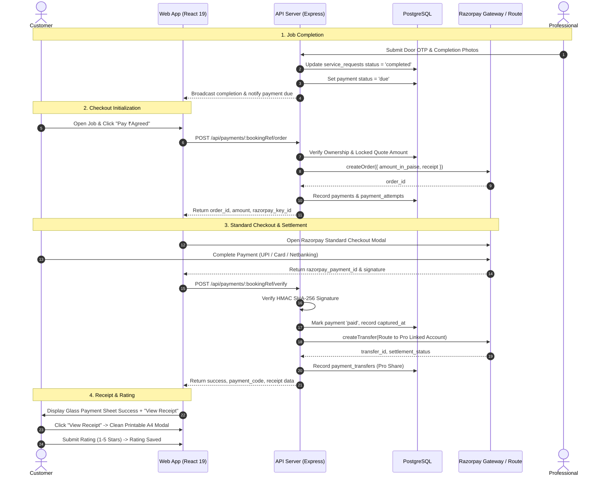
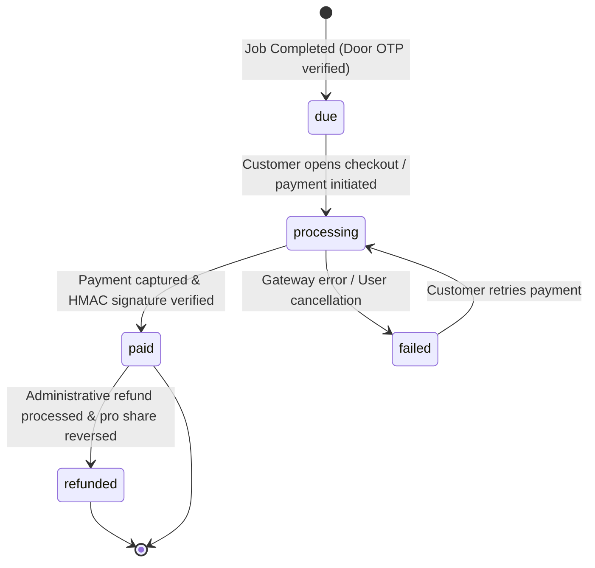

# NivaaroFix Online Payments & Route Settlements

This document details the online payments architecture, state transitions, security guarantees, and Razorpay Standard Checkout & Route settlement integration for NivaaroFix.

---

## 1. End-to-End Workflow



---

## 2. Payment State Machine



### State Definitions
- **`due`**: The professional has completed the work, verified the door OTP, and submitted completion proof. The agreed amount is due from the customer.
- **`processing`**: An order has been created with the gateway, or payment attempt is currently pending gateway authorization.
- **`paid`**: Funds captured by gateway, HMAC SHA-256 signature verified by server, and professional share transferred to their linked Route bank account.
- **`failed`**: The transaction was cancelled or declined. The customer may retry with the same or an updated payment method.
- **`refunded`**: An administrator authorized a partial or full refund. The payment record is updated and the professional transfer is reversed.

---

## 3. Strict Gating Rules

1. **Customer Unpaid Booking Lock**:
   - A customer **cannot** start a new booking while any completed job remains unpaid (`payment_status IN ('due', 'processing', 'failed')`).
   - Server returns HTTP `403` with code `UNPAID_COMPLETED_JOB` and `Pay for your previous service first.`
   - Customer UI opens the `UnpaidCompletedJobModal` with a direct "Pay now" action.
2. **Professional Payout Setup Lock**:
   - A professional **cannot** toggle Available or accept jobs without active payout setup (`payout_status = 'active'`).
   - Server returns HTTP `403` with code `PAYOUT_SETUP_REQUIRED`.
   - Ensures no job is dispatched to a professional who cannot receive direct automated settlement.

---

## 4. Configuration & Environment Variables

| Variable | Type | Default | Description |
|---|---|---|---|
| `PAYMENT_PROVIDER` | string | `mock` | `razorpay` for live gateway; `mock` for deterministic development/testing. |
| `RAZORPAY_KEY_ID` | string | `""` | Razorpay public key ID (`rzp_test_...` or `rzp_live_...`). |
| `RAZORPAY_KEY_SECRET` | string | `""` | Razorpay API secret key for HMAC signature verification. |
| `RAZORPAY_WEBHOOK_SECRET` | string | `""` | Secret for verifying incoming Razorpay webhook payloads. |
| `PLATFORM_FEE_PERCENT` | number | `0` | Configurable platform fee percentage (0-100, defaults to 0). |
| `PAYOUT_HOLD_HOURS` | number | `0` | Delay in hours before professional transfer auto-settles. |

---

## 5. Security & Financial Guarantees

1. **Integer Paise Storage**: All financial calculations (`amount`, `platform_fee`, `agent_amount`, `transferred_amount`) are computed in integer paise (1 INR = 100 paise) to prevent floating-point rounding errors.
2. **Zero Sensitive Card/Bank Storage**:
   - No card numbers, CVVs, expiry dates, or PAN numbers are ever stored in the database or written to logs.
   - Bank details are submitted directly to the payment gateway's secure endpoint; only the masked bank name and `bank_last4` (e.g., `•••• 4321`) are retained for display.
3. **Server-Decided Amounts**:
   - The client is **never** trusted for transaction amounts, status, or recipient accounts.
   - Order creation amounts are queried strictly from the server-locked `accepted_quote_id` on the database record.
4. **Timing-Safe HMAC Verification**:
   - Both client checkout signatures and server webhook signatures are verified using `crypto.timingSafeEqual` with SHA-256 HMACs to eliminate timing side-channel attacks.
5. **Idempotent Webhook Processing**:
   - Every incoming webhook event ID is recorded in `webhook_events`. Duplicate events return immediate HTTP `200` without triggering secondary transfers or mutations.

---

## 6. Provider Interface

```javascript
export class PaymentProvider {
  async createOrder({ amountPaise, currency = 'INR', receipt, notes = {} })
  async verifyCheckoutSignature({ orderId, paymentId, signature })
  async parseWebhook({ payload, signature, rawBody })
  async createLinkedAccount({ email, name, phone, bankAccount, ifsc, businessType })
  async createTransfer({ paymentId, accountId, amountPaise, currency = 'INR', notes = {} })
  async refund({ paymentId, amountPaise, notes = {} })
  async fetchPayment(paymentId)
}
```

Implementations:
- `RazorpayProvider`: Production driver communicating via HTTPS with Razorpay APIs and verifying signatures using native HMAC SHA-256.
- `MockPaymentProvider`: Deterministic in-memory test driver providing simulated checkout, valid/tampered signature generation, and webhook triggers.

---

## 7. Professional Route Settlement & Onboarding

1. Professional navigates to **Earnings & Payouts** in the Partner Console.
2. If `payout_status !== 'active'`, clicks **Set Up Bank Payouts**.
3. Enters IFSC, Account Number, Confirm Account Number, and PAN.
4. Verification:
   - Server calls `provider.createLinkedAccount(...)`.
   - On success, saves `provider_linked_account_id`, `bank_name`, and `bank_last4` (masked).
   - Sets `payout_status = 'active'`.
5. When a customer pays a completed job:
   - Standard Checkout captures the gross customer payment.
   - Server computes `agent_amount = gross_amount - platform_fee`.
   - Server triggers `createTransfer` routing `agent_amount` directly to the pro's linked account.
   - Record created in `payment_transfers` table with status `processed`.

---

## 8. Financial Reconciliation Runner

A background runner periodically reconciles any stuck `processing` payments or pending `transfers`:
- Inspects payments in `processing` older than 15 minutes.
- Queries `provider.fetchPayment(gateway_payment_id)`.
- Reconciles status to `paid` or `failed`.
- Retries any failed transfers up to 3 times with exponential backoff.

