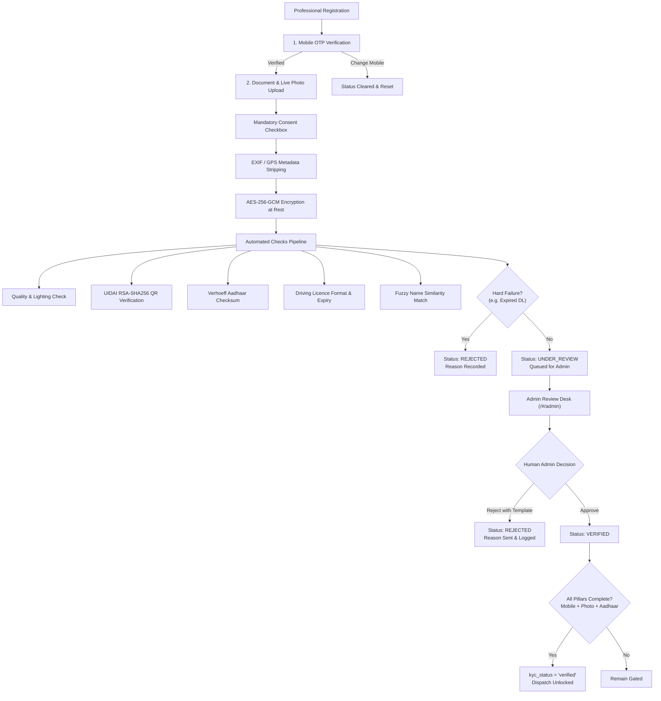

# Professional Identity & Document Verification System

## 1. Architectural Overview & Regulatory Principles

The NivaaroFix Professional Identity & Document Verification System establishes a high-trust, compliant onboarding and dispatch gating pipeline for service professionals (Electricians and Plumbers). It is built strictly with free and open-source software, avoiding expensive proprietary SaaS lock-ins while maintaining strict Indian legal and regulatory compliance.

### Core Principles
1. **Automated Checks Assist; Human Admins Decide**: Automated algorithms perform validation, quality checks, checksums, and signature verifications. A human administrator makes the final approval or rejection decision. The system never auto-approves. Automated hard failures (such as expired licences or unreadable files) trigger rejection reasons upfront.
2. **Strict Indian Regulatory Compliance**:
   - **Verhoeff Checksum**: 12-digit Indian Aadhaar validation using the canonical dihedral group $D_5$ Verhoeff algorithm.
   - **UIDAI Secure QR Verification**: 2048-bit RSA-SHA256 digital signature verification directly against UIDAI's published public certificate.
   - **DLT Compliant SMS**: OTP delivery adheres to TRAI Distributed Ledger Technology regulations.
3. **Data Minimization & Zero-Leak Privacy**:
   - **No Full Aadhaar Persistence**: Under UIDAI regulations, full 12-digit Aadhaar numbers and biometric facial templates are never stored on disk or in the database. Only the last 4 digits (`aadhaar_last4`) and verification results are persisted.
   - **No Plain OTPs**: Mobile OTPs are stored exclusively as salted HMAC-SHA256 hashes (`code_hash`), with 5-minute expiry, 30-second cooldown, and max 5 attempts.
   - **AES-256-GCM Encrypted Storage**: All uploaded identity documents and portraits are stripped of EXIF/GPS metadata and encrypted at rest with authenticated AES-256-GCM prior to storage outside the web root.
   - **Short-Lived Signed URLs**: Previews are delivered via HMAC-signed, time-limited URLs requiring authenticated admin access.
4. **Dispatch Gating**:
   - Professionals cannot switch to `is_online = true` or `availability_status = 'available'`, nor receive automated dispatches, until all three verification pillars are satisfied:
     1. Verified Mobile Number (`is_phone_verified = true`)
     2. Approved Live Portrait Photo (`photo_verified = true`)
     3. Approved Aadhaar Identity Card (`aadhaar_verified = true`)
     4. Linked Payout Account (`payout_status = 'active'`)

---

## 2. Verification Flow & State Machine



---

## 3. Provider Abstraction Architecture

### SMS Provider (`apps/api/src/modules/verification/providers/SmsProvider.js`)
- **`MockSmsProvider`**:
  - Used in development and automated testing environments.
  - Logs one-time passwords cleanly to the local terminal.
  - Strictly refuses execution in production (`NODE_ENV === 'production'`).
- **`DltSmsProvider`**:
  - Production provider integrated with DLT-compliant Indian telecom gateways (Fast2SMS, MSG91, 2Factor).
  - Sends compliant template-based messages with pre-registered Sender IDs and Entity IDs.

### KYC Provider (`apps/api/src/modules/verification/providers/KycProvider.js`)
- **`LocalKycProvider`**:
  - Free and open-source local processing engine.
  - Verifies image dimensions, luminance, sharpness, and quality variance without third-party services.
  - Parses UIDAI secure QR codes, unpacks compressed payloads, and checks 2048-bit RSA signatures.
  - Computes advisory facial similarity hint scores between live camera selfies and document photos.
- **DigiLocker Upgrade Path**:
  - Implements the exact same `KycProvider` interface. Switching to an official DigiLocker aggregator in the future requires only setting an environment variable (`KYC_PROVIDER=digilocker`) without altering frontend forms, APIs, or database schemas.

---

## 4. Configuration & Environment Variables

| Variable | Description | Default / Example |
| :--- | :--- | :--- |
| `DOC_ENCRYPTION_KEY` | 256-bit encryption key for document encryption at rest (AES-256-GCM) | Set in `.env` |
| `SIGNED_URL_SECRET` | Secret key used to generate short-lived HMAC-SHA256 file preview tokens | Set in `.env` |
| `OTP_SECRET` | Server secret for hashing mobile verification codes | Set in `.env` |
| `SMS_PROVIDER` | Active SMS provider implementation (`mock` or `dlt`) | `mock` (dev) / `dlt` (prod) |
| `DLT_ENTITY_ID` | Telecom Enterprise Registration Number | `1101XXXXXXXXXXXX` |
| `DLT_SENDER_ID` | 6-character registered Header / Sender ID | `NIVAAR` |
| `DLT_TEMPLATE_OTP` | Approved DLT Content Template ID for mobile OTPs | `1107XXXXXXXXXXXX` |
| `SECURE_DOC_STORAGE_PATH`| Absolute filesystem directory for encrypted files | `storage/secure_documents` |

---

## 5. Telecom DLT Setup Guide (TRAI Regulations)

To send transactional OTP SMS in India, follow these steps with any telecom operator portal (Jio, Airtel, Vilpower, BSNL, or Vodafone):

1. **Entity Registration**:
   - Register your business entity as an Enterprise on any TRAI-approved portal.
   - Obtain your 14-digit Principal Entity ID (`DLT_ENTITY_ID`).
2. **Sender ID (Header) Registration**:
   - Register a 6-character alphabetic header matching your brand (e.g. `NIVAAR` or `NIVFIX`).
   - Categorize as **Service Implicit / Transactional**.
3. **Content Template Registration**:
   - Register the OTP content template:
     ```text
     {#var#} is your verification code for NivaaroFix. Valid for 5 minutes. Do not share this code with anyone. - NivaaroFix
     ```
   - Note the approved Template ID (`DLT_TEMPLATE_OTP`). Approval typically takes 24 to 48 business hours.
4. **Provider Webhook / API Key**:
   - Enter your DLT credentials in `.env`:
     ```env
     SMS_PROVIDER=dlt
     SMS_GATEWAY_URL=https://api.gateway.com/v1/send
     SMS_API_KEY=your_production_gateway_api_key
     DLT_ENTITY_ID=1101XXXXXXXXXXXX
     DLT_SENDER_ID=NIVAAR
     DLT_TEMPLATE_OTP=1107XXXXXXXXXXXX
     ```

---

## 6. UIDAI Public Certificate Management

The system authenticates genuine Aadhaar QR codes using UIDAI's published 2048-bit RSA public key certificate.

- **Certificate Path**: [`apps/api/src/config/uidai/uidai_auth_sign.cer`](../apps/api/src/config/uidai/uidai_auth_sign.cer)
- **Certificate Setup & Rotation**:
  To initialize or rotate the certificate:
  ```bash
  node scripts/setup_uidai_cert.mjs
  ```
- **Digital Signature Verification Process**:
  1. The QR code binary buffer is decompressed using zlib.
  2. The last 256 bytes represent UIDAI's RSA-SHA256 signature.
  3. The leading byte stream contains delimiter-separated text fields (`0xFF`).
  4. Node's native `crypto.createVerify('RSA-SHA256')` validates the signature against the public certificate.

---

## 7. Administrative Review & CLI Tools

### Creating an Administrator Account
Admins are created via secure CLI to avoid unauthenticated web sign-ups:
```bash
node scripts/create_admin.js admin@nivaarofix.com "SecurePass123!" "Operations Lead"
```

### Accessing the Verification Desk
- Launch the web client: `http://localhost:5173/#/admin`
- Log in with administrative credentials.
- The desk provides:
  - **Review Queue**: Filterable by status (`under_review`, `verified`, `rejected`) and trade.
  - **High-Resolution Previews**: Secure decrypted rendering via time-limited signed URLs.
  - **Automated Check Inspection**: View lighting scores, blur scores, UIDAI signature validity, Verhoeff status, and fuzzy name similarity.
  - **Standardized Rejection Templates**:
    - `UNREADABLE_IMAGE`: Blurry, cut off, or low-contrast document.
    - `WRONG_DOCUMENT_TYPE`: Not an official identity document.
    - `EXPIRED_LICENCE`: Driving licence expired.
    - `NAME_MISMATCH`: Name does not match registered profile.
    - `FACE_MISMATCH`: Live portrait does not match ID document portrait.
    - `PHOTO_POOR_QUALITY`: Face not centered or poorly illuminated.
  - **Audit Ledger**: Complete audit trail showing timestamps, administrator email, action codes, and IP addresses.

---

## 8. Data Retention & Privacy Policy

- **Retention Window**: 30 days post-approval.
- **Cleanup Routine**:
  - The retention cleanup job can be scheduled or triggered manually:
    ```bash
    POST /api/verification/retention/run
    ```
  - For all documents and photos approved more than 30 days prior, the raw encrypted image files are securely unlinked and deleted from storage.
  - Database rows retain the verification timestamp, administrator ID, rejection reasons (if any), and `aadhaar_last4` for compliance and re-verification checks.
  - Unapproved or pending files are retained until resolved.

